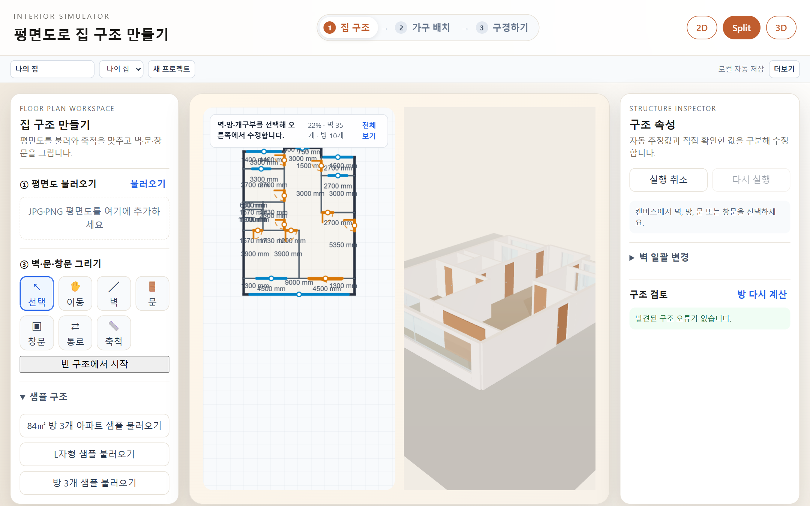

# Interior Simulator

**평면도로 집 구조를 만들고, 가구를 배치해 보고, 3D로 둘러보는 인테리어 배치 웹앱**

[](https://jhpark-coder.github.io/Interior-Simulator/)
[](https://github.com/jhpark-coder/Interior-Simulator/actions/workflows/ci.yml)
[](https://github.com/jhpark-coder/Interior-Simulator/deployments/github-pages)

👉 **https://jhpark-coder.github.io/Interior-Simulator/**
설치 없이 브라우저에서 바로 써 볼 수 있습니다. `집 구조` 단계의 **샘플 구조 → 84㎡ 방 3개 아파트**를 누르면 예시 집이 열립니다.



---

## 무엇을 하는 앱인가

이사 갈 집이나 리모델링할 집의 평면도를 불러와 벽·문·창문을 그리고, 가구를 실제 치수대로 놓아 본 뒤 3D로 걸어 다니며 확인합니다. 모든 데이터는 브라우저 안에서만 처리되고 저장됩니다.

| 단계 | 하는 일 |
|---|---|
| **1. 집 구조** | JPG·PNG·PDF 평면도 불러오기, 치수선으로 축척 맞추기, 벽·문·창문·통로 그리기, 구조 오류(열린 끝점·교차) 검사 |
| **2. 가구 배치** | 가구·가전·설비를 실제 크기로 배치, 벽 관통·문 열림 방해 자동 감지, 통행 폭(600·900mm) 표시, 배치안 여러 개 비교 |
| **3. 구경하기** | 3D 전체 화면으로 둘러보기, 1인칭 이동(벽·가구 충돌 처리), 문·창문 클릭해 열고 닫기 |

그 밖에 사진·메모를 도면 위치와 함께 남기는 **공간 기록**, 구조 스냅샷을 저장하는 **구조 리비전**, 전체 데이터를 한 파일로 묶는 **백업 패키지(`.interior-project`)** 를 지원합니다.

## 기술 스택

| 영역 | 사용 기술 |
|---|---|
| UI | React 19, TypeScript (strict), Vite |
| 2D 편집기 | Konva, react-konva |
| 3D 장면 | Three.js, React Three Fiber, drei |
| 상태 관리 | Zustand (도메인별 slice) |
| 저장 | IndexedDB (`idb`), JSZip, Zod 스키마 검증 |
| 평면도 처리 | PDF.js, Tesseract.js(OCR), Web Worker |
| 테스트 | Vitest, Testing Library, Playwright |
| CI/CD | GitHub Actions, GitHub Pages |

## 설계 포인트

- **2D와 3D가 같은 상태를 본다** — 편집기와 3D 장면이 하나의 Zustand 상태를 공유해서, 2D에서 벽을 옮기면 3D가 바로 따라 바뀝니다. Split 화면에서 둘을 나란히 볼 수 있습니다.
- **데이터를 잃지 않는 저장** — 5초 간격 자동 저장에 더해, 탭을 숨기거나 닫을 때·다른 프로젝트를 열기 전에도 먼저 저장합니다. 불러오는 데이터는 Zod 스키마로 검증하고, 구형 형식(LayoutDoc v1.x)은 마이그레이션으로 현재 형식(v2)으로 바꿉니다.
- **무거운 작업은 메인 스레드 밖에서** — 평면도 선분 인식은 Web Worker에서 돌고, PDF·OCR·3D 코드는 필요할 때만 불러오도록 나눠 첫 화면 로딩을 가볍게 했습니다.
- **로컬 우선** — 평면도와 사진은 서버로 보내지 않습니다. 3D 조명용 환경맵도 앱에 포함해 오프라인에서도 3D가 동작합니다.

## 테스트와 배포

- 단위·컴포넌트 테스트 **315개** (Vitest, 44개 파일)
- E2E 테스트 (Playwright, 저장·복원·배치안·문 열림 방해 등 사용자 시나리오)
- `main` 푸시와 PR마다 GitHub Actions가 lint → 단위 테스트 → 빌드 → E2E를 실행합니다.
- `main`에 앱 코드가 합쳐지면 위 검사가 **모두 통과한 뒤에만** 빌드해 GitHub Pages에 자동 배포합니다. 하나라도 실패하면 배포하지 않고 이전 버전이 그대로 남습니다.

## 로컬에서 실행

Node.js `^20.19.0` 또는 `>=22.12.0`이 필요합니다. 앱은 저장소의 `Interior-Simulator/` 폴더에 있습니다.

```bash
cd Interior-Simulator
npm install --legacy-peer-deps
npm run dev          # http://localhost:5173
```

```bash
npm run lint         # 정적 검사
npm run test:run     # 단위 테스트
npm run test:e2e     # E2E (처음 한 번: npx playwright install chromium)
npm run build        # 프로덕션 빌드
```

## 더 보기

- [상세 사용법·단축키·파일 형식](Interior-Simulator/README.md)
- [구현 현황](Interior-Simulator/docs/IMPLEMENTATION_STATUS.md)
- [평면도 → 3D 개발 계획](Interior-Simulator/docs/FLOORPLAN_TO_3D_DEVELOPMENT_PLAN.md)

> 현재는 기능 검증 단계의 베타입니다. 자동 테스트는 통과하지만, 다양한 실제 평면도에 대한 자동 인식 정확도는 계속 다듬고 있습니다.
